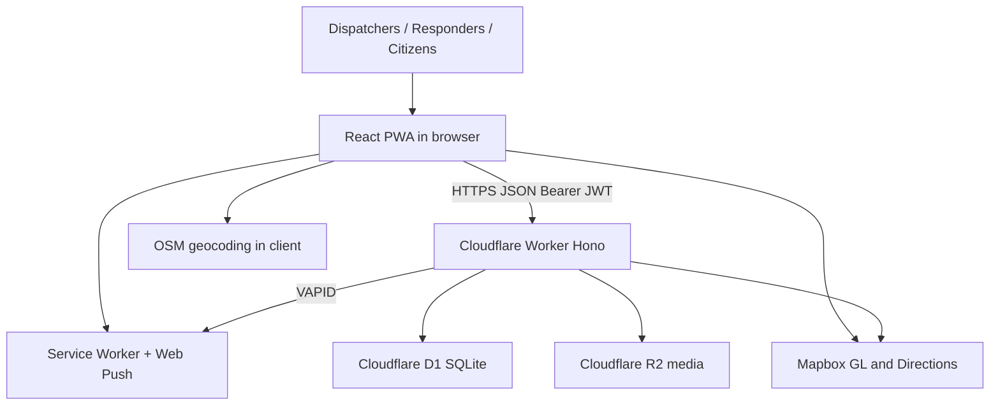
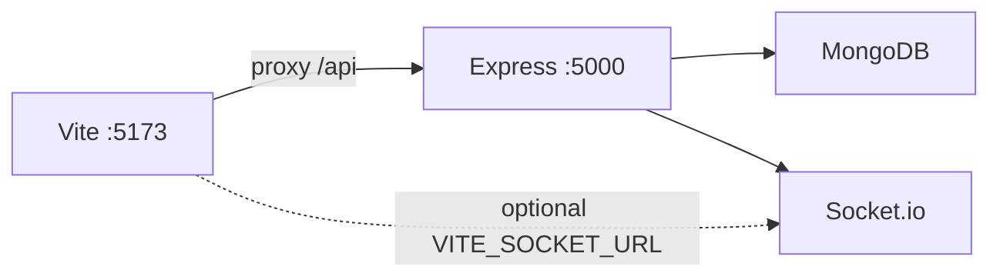
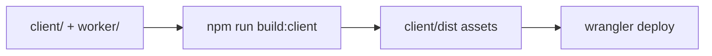
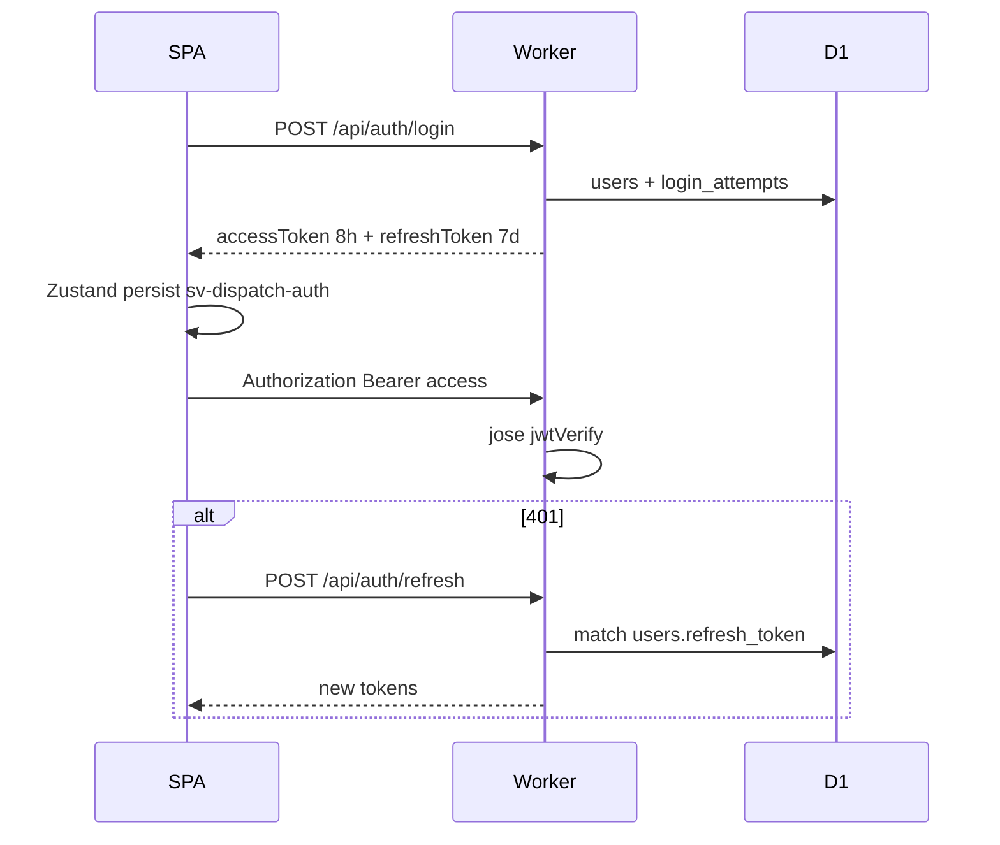
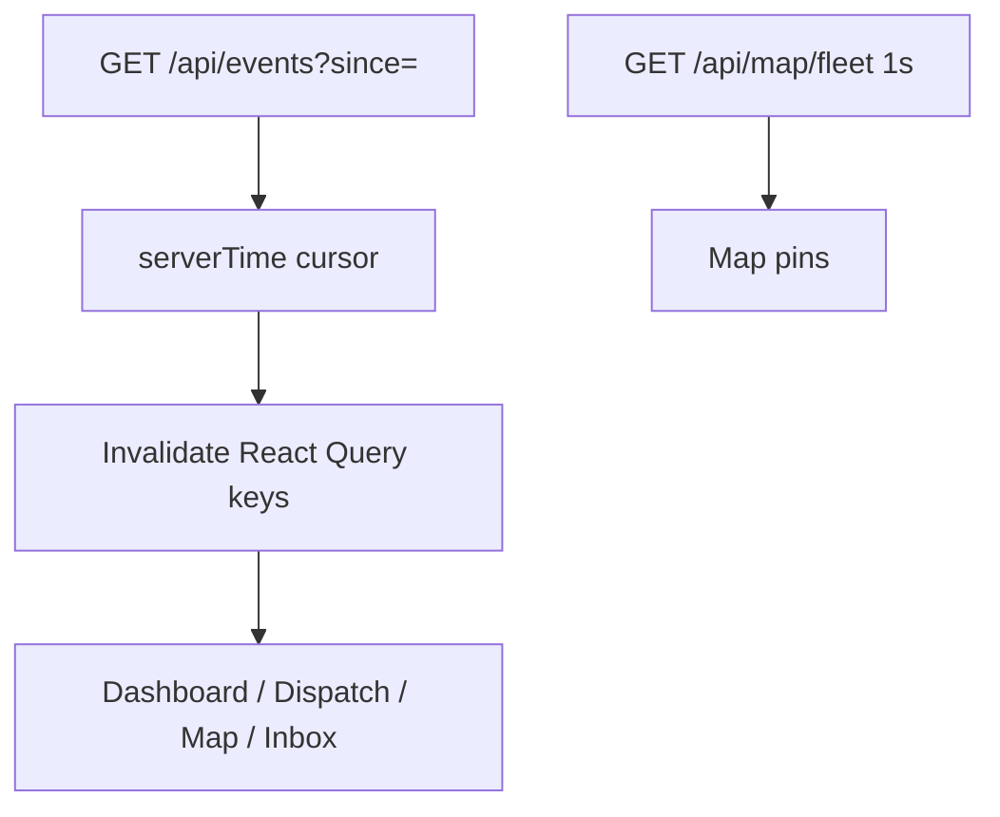
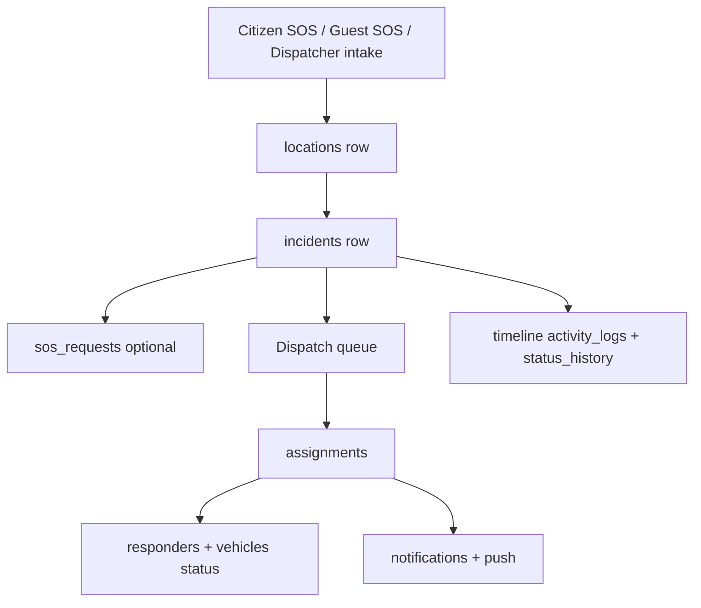
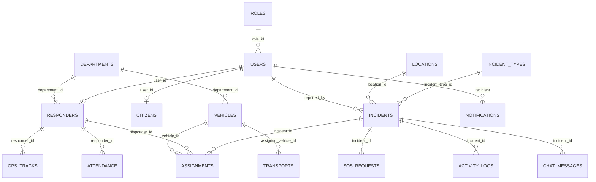
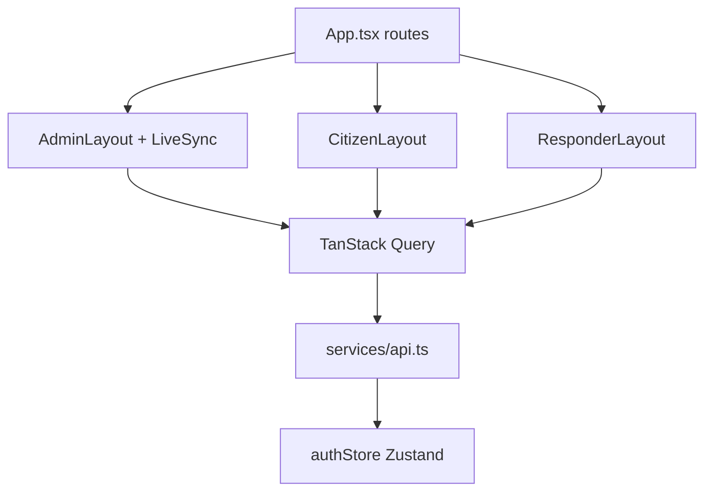

# Architecture

## High-level architecture

Production is a single Cloudflare Worker that serves the Vite-built SPA from assets and handles `/api/*` against D1 (and R2 for media).



Local `npm run dev` is a **different** topology:



Do not assume production uses MongoDB or Socket.io.

---

## Process and deploy



`wrangler.jsonc`: `run_worker_first: ["/api/*"]`, SPA `not_found_handling`. Custom domain `emergency.brigadaonse.org`.

Optional `render.yaml` describes an Express Docker service; that is **not** the documented production path in `docs/DEPLOY.md`.

---

## Authentication



Role home paths: citizen `/citizen`, responder `/responder`, else `/admin/dashboard`.

---

## Live updates (production)



Express Socket.io rooms (`dispatch`, `user:id`, `incident:id`) exist only on the local server.

---

## Incident data flow



---

## Database relationships



---

## Frontend module map



---

## Worker module map

```text
worker/index.ts          core REST + JWT + CORS
worker/extended.ts       extra REST (events, media, guest SOS, …)
worker/lib/core.ts       RBAC, transitions, crypto, IDs
worker/lib/notify.ts     in-app + push fanout
worker/lib/webpush.ts    VAPID
worker/lib/assignmentLifecycle.ts
worker/lib/routing.ts
worker/lib/pdf.ts
worker/schema.sql + migrate-v*.sql
```

---

## Trust boundaries

| Boundary | Mechanism |
|----------|-----------|
| Browser → API | HTTPS, CORS allowlist, JWT |
| API → D1 | Worker binding, parameterized SQL |
| API → R2 | `MEDIA` binding, auth on upload/get |
| Maps | Public Mapbox token (restrict by URL in Mapbox) |
| Push | VAPID keys; private key must be a Worker secret |

SPA JWT in localStorage is reachable by XSS. Treat input sanitization and CSP (if added later) as relevant; Helmet CSP applies to Express only, not the Worker SPA.
